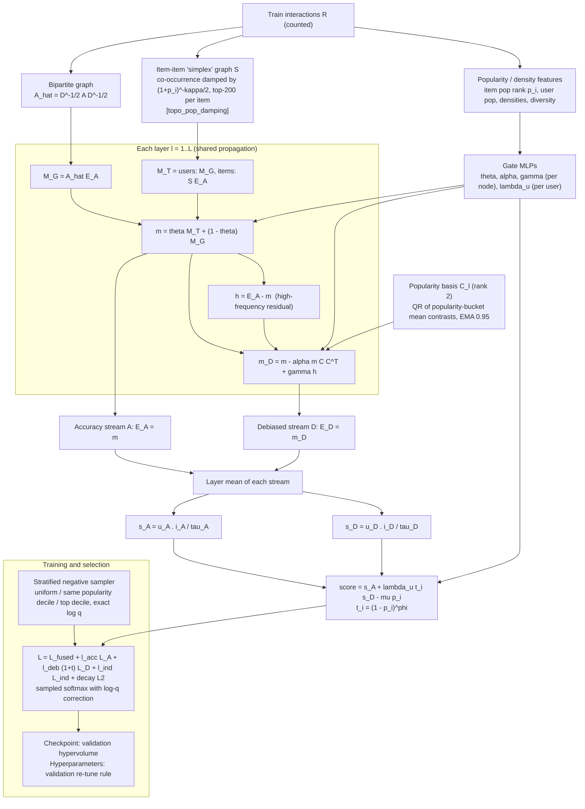

# ASTD-PD: Adaptive Spectral-Topological Debiasing with Pareto Dual-Stream Fusion

MSc thesis benchmark. This file is the only document of the `thesis/` folder. Every result
number below sits between generated markers and is written by `python run.py report` from
`results/results.json`; the rest of the text contains no result numbers of this benchmark except
where a file is cited next to them.

## 1. Abstract

Graph-convolutional recommenders such as LightGCN propagate preference signal over the
user-item graph. High-degree items enter almost every user's neighbourhood, so propagation
pulls embeddings toward the popular head and amplifies popularity bias: recommendation lists
concentrate on few items and the long tail is rarely exposed. ASTD-PD (Adaptive
Spectral-Topological Debiasing with Pareto Dual-Stream Fusion) is a dual-stream LightGCN variant.
An accuracy stream propagates over the bipartite graph mixed with a popularity-damped item-item
graph. A debiased stream removes a learned low-rank popularity subspace from each layer's
message. The two are fused per user with a tail weight. Training uses a popularity-stratified
negative sampler with an exact log-Q correction, and inference can subtract a popularity penalty.

The thesis compares ASTD-PD with the official LightGCN backbone and three official post-hoc
debiasing methods applied to that backbone: PPD (WWW 2026), TSP (NeurIPS 2025) and DAP (FCS 2023).
The comparison covers four datasets (Coat, Yahoo!R3, KuaiRec, Gowalla) and five seeds. Every
hyperparameter is selected on validation, and every margin is tested across seeds and per user.
ASTD-PD's hyperparameters are re-tuned on validation with a pre-registered rule: maximise
accuracy subject to recommending less popular items than the best baseline. Whether that
transfers to test, and at what accuracy cost, is reported per dataset below. An earlier ablation attributes most of the popularity reduction to the negative sampler,
not to the spectral component the method is named after. Current headline (auto-generated):

<!-- HEADLINE:BEGIN -->
- **Coat**: lowest test AvgPop@20 = ASTD-PD. ASTD-PD 16.2 vs the least popular baseline (TSP) 20.8 (-22.0%, Holm p = 0.01 across seeds / 1.8e-155 per user); NDCG@20 -23.3% and Recall@20 -27.4% vs LightGCN.
- **Yahoo**: lowest test AvgPop@20 = ASTD-PD. ASTD-PD 289.6 vs the least popular baseline (TSP) 290.7 (-0.4%, Holm p = 0.9 across seeds / 1.3e-07 per user); NDCG@20 -16.7% and Recall@20 -21.3% vs LightGCN.
- **KuaiRec**: lowest test AvgPop@20 = ASTD-PD. ASTD-PD 1433.6 vs the least popular baseline (TSP) 1475.9 (-2.9%, Holm p = 0.21 across seeds / 9.6e-30 per user); NDCG@20 -9.0% and Recall@20 -4.9% vs LightGCN.
- **Gowalla**: lowest test AvgPop@20 = ASTD-PD. ASTD-PD 23.2 vs the least popular baseline (TSP) 30.8 (-24.8%, Holm p = 9.5e-05 across seeds / 0 per user); NDCG@20 -75.8% and Recall@20 -72.7% vs LightGCN.
<!-- HEADLINE:END -->

## 2. Experimental setup and hardware

| Component | Value |
|---|---|
| CPU | AMD Ryzen Threadripper 2990WX, 32 cores / 64 threads |
| RAM | 121 GiB |
| GPU | 2 x NVIDIA GeForce RTX 3090, 24 GB each |
| NVIDIA driver | 595.84 (supports CUDA up to 13.2) |
| CUDA runtime | 13.0 (bundled with the PyTorch cu130 wheels; cuDNN 9.20) |
| OS | Linux, kernel 7.0.0-30-generic |
| Python | 3.12.14 (conda) |
| PyTorch | 2.13.0+cu130 |
| Other pinned packages | numpy 2.5.2, scipy 1.18.1, pandas 3.0.5, scikit-learn 1.9.0, networkx 3.6.1, TopoNetX 0.4.0, PyYAML 6.0.3 (full list: `environment.yml`) |

The benchmark ran in a conda env named `gMasters`. `environment.yml` pins the same versions under
the env name `thesis`.

**How the machine is used.** `python run.py all` runs a dependency-aware job scheduler
(`run.py:step_all`):

- **GPU jobs.** LightGCN training, the TSP and DAP grids and ASTD-PD go to 2 GPUs x 3 slots, so
  at most 6 jobs run at once. Each new job goes to the least-loaded GPU and gets 4 CPU threads.
- **CPU jobs.** PPD's official loops are pure Python and single-threaded, so they run in a pool
  of 18 one-thread CPU processes. For each backbone, one job computes the popularity scores *p*.
  Then one job per beta computes *b(beta)* and scores both phi values. A final job selects the
  winner on validation.
- **Order and logs.** Datasets run small first (Coat, Yahoo, KuaiRec, Gowalla). Each job depends
  on its backbone. The report job runs last. Per-job wall times go to `logs/jobs.jsonl` and live
  progress to `logs/status.txt`.
- **ASTD-PD re-tuning.** `scripts/astdpd_tune_all.sh` runs alongside the scheduler. It uses a
  pool of 6 workers (3 per GPU, 2 threads each), searches one dataset at a time, and starts a
  dataset only after its baselines exist.

## 3. Repository layout

```
thesis/
  run.py                    single entry point: backbone | baselines | astdpd | report | all
  environment.yml           pinned conda environment
  configs/
    backbone.yaml           LightGCN hyperparameters per dataset (+ selection: eval_every, patience)
    grids.yaml              validation grids of PPD / TSP / DAP, with the source of every range
    astdpd.yaml             shipped ASTD-PD configuration per dataset
    astdpd_selected.yaml    validation-retuned ASTD-PD configurations (written by src/astdpd/tune.py)
  data/<Dataset>/{train,valid,test}.txt   fixed splits (from the official PPD repo) + SHA256SUMS
  src/
    data.py                 split loader (official-Loader semantics, KuaiRec candidate universes)
    evaluate.py             the single evaluator used by every method (all metrics)
    significance.py         paired t-test over seeds + per-user Wilcoxon, Holm-adjusted
    backbone.py             trains the official LightGCN-PyTorch, unmodified, with validation selection
    methods/                adapters: ppd.py, tsp.py, dap.py; tune.py = validation grid search
    astdpd/                 model.py, sampler.py, train.py, tune.py (validation re-tune)
  third_party/              byte-identical upstream code at pinned commits (SOURCES.txt)
  scripts/
    run_all.sh              whole benchmark via `run.py all`
    astdpd_tune_all.sh      ASTD-PD re-tune of Yahoo, KuaiRec, Gowalla alongside run_all
    verify_third_party.sh   re-clone every upstream repo and diff it against third_party/
  runs/                     per dataset/seed outputs (not tracked by git)
  results/                  results.json, significance.json, tables.txt (generated)
  logs/                     scheduler log, per-job logs, jobs.jsonl, status.txt
```

## 4. Setup

```bash
conda env create -f environment.yml          # creates env `thesis`
conda activate thesis
python -c "import torch; print(torch.__version__, torch.cuda.is_available())"

cd thesis
(cd data && sha256sum -c SHA256SUMS)         # the 12 split files
bash scripts/verify_third_party.sh           # needs network: re-clones the 4 repos at their pinned commits
```

The data ships with the folder. `data/<ds>/{train,valid,test}.txt` are byte-identical to the
split files of the official PPD repository; that repo's `data/` folder is the one path excluded
from vendoring (see `third_party/SOURCES.txt`). Nothing under `third_party/` is ever edited. Every
workaround lives in `src/` and is described in §7.

## 5. Reproduce

The whole benchmark, in the order it was run (from `thesis/`):

```bash
# 1. Coat end to end (backbones, baselines, shipped-config ASTD-PD, report)
bash scripts/run_all.sh --datasets Coat
# 2. Coat ASTD-PD re-tune: defaults --n-random 160 --top-k 8 --confirm-seeds 3. Installs the
#    winner as astdpd.*, keeps the shipped runs as astdpd_shipped.*
python -m src.astdpd.tune --dataset Coat --workers 6 --gpu 0 1
# 3. The other datasets, with the re-tune of Yahoo, KuaiRec and Gowalla running alongside
setsid nohup bash scripts/run_all.sh --datasets Yahoo KuaiRec Gowalla > /dev/null 2>&1 &
PY=$(which python) setsid nohup bash scripts/astdpd_tune_all.sh > logs/astdpd_tune_all.log 2>&1 &
# 4. Tables (also run automatically by steps 1, 3 and each re-tune's final step)
python run.py report
```

`scripts/astdpd_tune_all.sh` must run alongside `run_all.sh`, not after it:

- It waits for each dataset's baselines, since the selection threshold needs their validation
  AvgPop.
- The search writes nothing that `run.py` reads. Its final step waits until `run.py all` has
  finished the shipped-config ASTD-PD runs (`--wait`). Only then does it write
  `configs/astdpd_selected.yaml`, rename the shipped runs to `astdpd_shipped.*`, install the
  winner as `astdpd.*` and regenerate the report.
- If the scheduler is no longer running, it trains any missing shipped runs itself.

`PY` defaults to the author's env path, so set it as shown. Every step is idempotent: rerun the
same command to resume.

Per-step commands (each takes `--datasets`, `--seeds`, `--gpu N` with `-1` = CPU, `--threads`):

```bash
python run.py backbone                       # (a) LightGCN, validation-selected checkpoint
python run.py baselines --methods ppd tsp dap   # (b-d) validation grid, winner scored on test
python run.py astdpd                         # (e) ASTD-PD with configs/astdpd_selected.yaml if listed, else astdpd.yaml
python run.py report                         # results/ + this README's generated regions
python -m src.astdpd.tune --dataset D [--n-random N --top-k K --mu-grid ...]
```

**Wall time.** These are measured per job in `logs/jobs.jsonl` with 6 GPU jobs and up to 18 CPU
jobs sharing the machine, so they are not single-job timings. Ranges are min to max over the 5
seeds. Gowalla DAP and ASTD-PD, and KuaiRec ASTD-PD, were still running when this was written
(status at 2026-10-03 09:32, `logs/status.txt`).

| Dataset | LightGCN | PPD prep / per beta (CPU) | TSP grid | DAP grid | ASTD-PD (shipped) | ASTD-PD re-tune search |
|---|---|---|---|---|---|---|
| Coat | 0.3-0.4 min | 0.2 / 0.2 min | 0.3-0.4 min | 0.4-0.6 min | 0.3 min | 189 trials, 1.9 GPU-h summed |
| Yahoo | 2.4-3.2 min | 1.0 / 1.3 min | 7-10 min | 30-45 min | 4.6-4.7 min | 85 trials, 3.2 GPU-h summed; 1.65 h elapsed |
| KuaiRec | 32-38 min* | 4.6-5.5 / 111-118 min | 24-27 min | 23-41 min | 81 min (1 seed so far) | running |
| Gowalla | 3.6-4.7 h | 81-89 / 28-31 min | 29-36 min | > 3.7 h (running) | not started | not started |

\* Seed 2024's KuaiRec backbone job took 5 s: its checkpoint already existed from an earlier invocation, so the job skipped training. The range covers the other 4 seeds. The
scheduler reached this point after 8.9 h of elapsed time, with Gowalla's DAP grid the critical
path. `configs/grids.yaml` documents the PPD and DAP costs on a single job.

**Where outputs land.**

| Path | Content |
|---|---|
| `runs/<ds>/seed<s>/lightgcn.{pt,json}` | backbone checkpoint, validation curve, valid + test metrics |
| `runs/<ds>/seed<s>/{ppd,tsp,dap}_selected.json` | full validation grid table, selected point, its valid + test metrics |
| `runs/<ds>/seed<s>/grid/`, `ppd_cache/` | cached grid rows / official PPD intermediate outputs (resume) |
| `runs/<ds>/seed<s>/astdpd.{pt,json}` | ASTD-PD (retuned config when listed in `astdpd_selected.yaml`) |
| `runs/<ds>/seed<s>/astdpd_shipped.*` | ASTD-PD with the shipped config (kept after a re-tune) |
| `runs/<ds>/seed<s>/*_per_user_test.npz` | per-user test vectors for the significance tests |
| `runs/<ds>/astdpd_tune.json` | every re-tune configuration with validation metrics only, and the selection record |
| `results/{results,significance}.json`, `results/tables.txt` | aggregated tables (generated) |

## 6. Protocol

### Datasets

Computed with `src.data.load` on the shipped splits. The users and items counts are 1 + the
maximum id in any split, as in the official loader.

| Dataset | users | items | train pairs (rows) | train density | valid users / pairs | test users / pairs | ranking universe |
|---|---|---|---|---|---|---|---|
| Coat | 290 | 300 | 3,622 | 4.16% | 261 / 617 | 281 / 1,245 | all 300 items |
| Yahoo!R3 | 14,382 | 1,000 | 88,684 | 0.62% | 11,130 / 36,393 | 2,383 / 4,671 | all 1,000 items |
| KuaiRec | 7,176 | 10,728 | 846,253 (936,390) | 1.10% | 1,410 / 71,535 | 1,410 / 145,181 | valid: 3,176 items; test: 3,247 items |
| Gowalla | 29,858 | 40,981 | 647,063 | 0.05% | 29,858 / 163,065 | 29,858 / 217,242 | all 40,981 items |

- **Splits** are the fixed files shipped with the official PPD repository. They are not
  re-split.
- **KuaiRec duplicates.** KuaiRec's `train.txt` repeats some (user, item) pairs: 936,390 rows,
  846,253 distinct pairs. The duplicates are counted exactly as the official LightGCN loader
  counts them (`csr_matrix` sums duplicates). Graphs, degrees, popularity features and AvgPop
  use the counts. Masking and positive sets use the binarised matrix.
- **KuaiRec ranking universe.** KuaiRec's valid and test sets come from the dense "small matrix",
  which covers about 30% of the catalogue. Each split is therefore ranked only within its own
  item universe, so the test universe never leaks into validation. All other datasets rank the
  full catalogue.

### Evaluation (`src/evaluate.py`, shared by every method)

- **Full ranking.** Every item is scored for every evaluated user. The user's training items
  are masked. Validation items are not masked when evaluating test.
- **Users.** Metrics average over the users of the evaluated split only. Test numbers use test
  users.
- **Long tail.** An item is long tail if it lies outside the top 20% of items by (counted)
  training degree.
- **Catalogue-level metrics.** Coverage and Gini are computed over all items.
- **Seeds and spread.** Seeds are 2024, 2025, 2026, 2027 and 2028. Tables show the mean ± the
  sample std (ddof = 1) over seeds.

| Metric (@10, @20) | Definition |
|---|---|
| Recall | hits in top-k / number of the user's relevant items |
| Precision | hits in top-k / k |
| NDCG | DCG of the top-k hits / ideal DCG with min(k, #relevant) hits |
| HR | 1 if the top-k has at least one hit |
| MRR | 1 / rank of the first hit (0 if none) |
| MAP | sum of precision at each hit position / min(k, #relevant) |
| AvgPop ↓ | mean training degree of the recommended items |
| APLT | fraction of recommended items that are long tail |
| Coverage | fraction of the catalogue recommended to at least one user |
| Gini ↓ | Gini coefficient of item exposure counts over the catalogue |
| TailRecall | long-tail hits / long-tail relevant items, over users with at least one long-tail relevant item |
| Novelty | mean self-information −log2(deg_i / n_users) of recommended items (deg floored at 1) |

### Model selection (validation only; test metrics are never read during selection)

| Method | Rule |
|---|---|
| LightGCN | official BPR training. Validation Recall@20 every 5 epochs, stop after 10 checks without improvement, cap 1000 epochs (official default), keep the best checkpoint. |
| PPD / TSP / DAP | every point of the `configs/grids.yaml` grid applied to the seed's trained backbone and scored on validation. Winner = highest valid Recall@20 (ties → NDCG@20), then evaluated once on test. Grid sources: PPD = the beta/phi values of the official README commands (3 x 2); TSP = paper App. G Table 5 ranges for K, beta, L (4 x 7 x 3) with theta/topk from the README command; DAP = the paper's ranges for alpha1, alpha2, P on a coarser lattice (6 x 3 x 4). |
| ASTD-PD, per run | Adam. Checkpoint selected on the validation Pareto hypervolume Recall@20 · NDCG@20 · Precision@20 · 1/(1 + AvgPop@20/1000), patience 20 epochs. The first min(10, epochs/2) epochs always overwrite the best. |
| ASTD-PD, hyperparameters | re-tuned on validation (`src/astdpd/tune.py`), described below. |

**ASTD-PD re-tune rule** (fixed before the search):

- **Threshold T.** For each seed, take the lowest validation AvgPop@20 among the four
  validation-selected baselines, then average over all five seeds (2024-2028). The mean over
  seeds 2024-2026 alone is logged for information only and never used for selection.
- **Choice.** Pick the configuration with the highest mean validation NDCG@20 subject to mean
  validation AvgPop@20 < T. If none is feasible, pick the lowest AvgPop and record that.
- **Stage 1.** The shipped config is crossed with an inference-penalty grid, and random
  configurations are drawn from a 10-knob space (sampler mix, phi, lambda_deb, lambda range,
  alpha_base, damping, lambda_ind, gamma, mu). Each is trained on seed 2024.
- **Stage 2.** The top-k configurations are trained on seeds 2024-2026, and the rule is applied
  to their means.
- **Final.** The winner is trained on the remaining seeds.
- **Budgets** (random / mu points / top-k): Coat 160 / 11 / 8, Yahoo 60 / 11 / 6,
  KuaiRec 18 / 11 / 4, Gowalla 7 / 5 / 3.
- **Shipped config kept.** The shipped-config runs stay as `ASTD-PD (shipped)`, a reference row
  that is not part of the popularity race.

**Epoch budget.** ASTD-PD keeps the previous harness's epoch budget: 50 epochs on Coat, 100
elsewhere. LightGCN may train up to 1000. If anything, this works against ASTD-PD: on Coat, 4 of
the 5 installed runs stop at the 50-epoch cap (`runs/Coat/seed*/astdpd.json`, `epochs_run`).

### Significance (`src/significance.py`)

ASTD-PD is compared against every other row on Recall@20, NDCG@20, Precision@20 and AvgPop@20
(test) with two tests:

- **Across seeds.** A paired t-test over the 5 per-seed values: does the margin survive
  retraining?
- **Per user.** A two-sided Wilcoxon signed-rank test on per-user differences, matched on user
  id and pooled over seeds: does the margin hold on the same users?

p-values are Holm-adjusted across the four metrics within each test. At n = 5, near-constant
differences inflate t. Read the effect size and the seed std, not only p.

## 7. Baselines (official code, unmodified)

| Method | Repository @ commit | Paper |
|---|---|---|
| LightGCN | gusye1234/LightGCN-PyTorch @ `947ca2b3b1d2d3545b114145710cb06c4e57b3d2` | He et al., SIGIR 2020 |
| PPD | edgeslab/Posthoc_Popularity_Debiasing @ `acdba3494407e9dbc5f257dc7a7c592dd3f50710` | Post-hoc Popularity Bias Correction in GNN-based Collaborative Filtering, WWW 2026 |
| TSP | sotaagi/TSP @ `0ebf889c95466d52413cedd1b06fdbc11e8385de` | Ji et al., NeurIPS 2025 |
| DAP | MEICRS/DAP @ `17ef6006961d70cb4947fd9d15010d7c77134cc8` | Chen et al., Frontiers of Computer Science 2023 |

`third_party/` is byte-identical to these commits; `scripts/verify_third_party.sh` checks this.
All three post-hoc methods work on the same trained LightGCN checkpoint of each seed. Adapter notes
(full detail in each module docstring):

**LightGCN (`src/backbone.py`)**

- The official `world`, `model`, `utils` and `Procedure` modules are imported unmodified. Data
  enters through a subclass of the official `Loader`, so the official `getSparseGraph` and BPR
  training are used as they are.
- The official C++ sampler (`sources/sampling.cpp` via cppimport) cannot be used here. Building
  it writes into the vendored tree, and it crashes on users without training items (one KuaiRec
  user). cppimport is therefore blocked, and the official Python fallback
  `UniformSample_original_python` is always used.
- The official code has no model selection, so the validation early stopping described in §6
  is added.
- Scores are raw inner products: the same ranking as the official sigmoid, without fp32
  saturation ties.

**PPD (`src/methods/ppd.py`)**

- Implements the official variant 3 (`VARIANT_VECTOR_BIAS_ZERO_LAYER_UPDATE`), as the official
  `main.py` runs it after training: `compute_global_popularity_score` → personalised preference
  → `compute_bias_scores` → `compute_d_pop_all_normalized` → `project_and_remove` on the layer-0
  embeddings.
- These official functions are called in the official order. The official pure-Python loops are
  used on every dataset; nothing is re-implemented.
- `compute_pop_bias_scores` itself is not called, because its tail runs PPD's own evaluator and
  writes into the repo.
- Import-time stubs: a `register` module with `dataset=None`, `sys.argv` set during import, and
  cppimport blocked.
- *p* and *b(beta)* are cached on disk, so the grid can be split over CPU processes.

**TSP (`src/methods/tsp.py`)**

- The upstream `main.py` is listed in the README but missing from the repository. The driver is
  written from the paper (Sec. 4, Alg. 1) and the docstrings of the official `tsp.py`.
- X0 is the backbone's layer-mean embeddings. `tsp.TSP(...)(X0)` is called unmodified, and the
  score is `<X_rec[u], X_rec[n_users+i]>`.
- The clique complex is memoised. The official class rebuilds the clique complex and its
  Laplacians on every call (250-600 s per call on Gowalla), although they depend only on the
  semantic graph and K.
- `graph_to_clique_complex` is therefore replaced at runtime by a memoised version that returns
  the same object. Values are identical to uncached calls: identical top-20 lists on Coat, with
  score differences ≤ 2e-7.

**DAP (`src/methods/dap.py`)**

- `DAP.py` is used unedited (`LightGCN.computer_DAP`, Eqs. 16-18), with the backbone's
  state_dict and normalised adjacency.
- It imports two symbols that exist in neither LightGCN-PyTorch nor the DAP repo, so they are
  supplied as import-time stubs:
  - `model.basic_model.BasicModel` is the official LightGCN-PyTorch `BasicModel`.
  - `utils.cos_similarity` is copied verbatim from the PPD repo's port of DAP
    (`third_party/PPD/LightGCN/code/DAP.py`). That definition is row-wise cosine, the only one
    consistent with its use in `DAP.py`.
- Some grid points crash inside the official code. Example: P ≥ 30 on Coat, where a cluster
  whose members share one degree gives a NaN anchor and the next Kmeans raises. Those points
  are logged with their error and excluded from selection (`src/methods/tune.py`).

**Known caveats**

- 129 of Coat's 1,245 test pairs also appear in Coat's training split. They are masked at
  ranking time, so they can never be hit, for every method alike.
- CUDA sparse matmuls are not bit-deterministic. Re-running gives score differences of about
  1e-7, which can occasionally flip exact ties.
- PPD's grid is small (6 points) because it is exactly the set of values in the official README
  commands.

## 8. Results

All rows are test metrics of validation-selected models. `ASTD-PD` is the validation-retuned
configuration where `configs/astdpd_selected.yaml` lists the dataset. `ASTD-PD (shipped)` is the
shipped configuration, kept as a reference row and excluded from the popularity race. Δ = ASTD-PD
minus the row's method; p = Holm-adjusted, across seeds / per user. Full metric set (HR, MRR,
MAP, Gini, Novelty, @10): `results/results.json`.

<!-- RESULTS:BEGIN -->
*Generated by `python run.py report` on 2026-10-04 03:07:59 from `results/results.json`; do not edit by hand. Test split, mean ± sample std over seeds [2024, 2025, 2026, 2027, 2028]; ↓ = lower is better.*

| Dataset | status | lowest AvgPop@20 | ASTD-PD AvgPop@20 ↓ | least-popular baseline AvgPop@20 (ASTD-PD change) | ASTD-PD vs LightGCN NDCG@20 | ASTD-PD vs LightGCN Recall@20 |
|---|---|---|---|---|---|---|
| Coat | complete | ASTD-PD | 16.2 | TSP 20.8 (-22.0%) | 0.0542 vs 0.0707 (-23.3%) | 0.0937 vs 0.1291 (-27.4%) |
| Yahoo | complete | ASTD-PD | 289.6 | TSP 290.7 (-0.4%) | 0.0530 vs 0.0636 (-16.7%) | 0.1109 vs 0.1409 (-21.3%) |
| KuaiRec | complete | ASTD-PD | 1433.6 | TSP 1475.9 (-2.9%) | 0.3704 vs 0.4070 (-9.0%) | 0.1696 vs 0.1783 (-4.9%) |
| Gowalla | complete | ASTD-PD | 23.2 | TSP 30.8 (-24.8%) | 0.0340 vs 0.1409 (-75.8%) | 0.0456 vs 0.1671 (-72.7%) |

### Coat

| Method | Recall@20 | NDCG@20 | Precision@20 | AvgPop@20 ↓ | APLT@20 | Coverage@20 | TailRecall@20 | Recall@10 | NDCG@10 | AvgPop@10 ↓ | seeds | time/seed (s) |
|---|---|---|---|---|---|---|---|---|---|---|---|---|
| LightGCN | 0.1291 ± 0.0115 | 0.0707 ± 0.0033 | 0.0227 ± 0.0017 | 25.8 ± 1.4 | 0.2909 ± 0.0627 | 0.6460 ± 0.1394 | 0.0383 ± 0.0083 | 0.0710 ± 0.0065 | 0.0503 ± 0.0013 | 30.7 ± 2.0 | 5 | 13 |
| PPD | 0.1226 ± 0.0149 | 0.0671 ± 0.0047 | 0.0222 ± 0.0017 | 24.1 ± 1.6 | 0.3637 ± 0.0637 | 0.7907 ± 0.1277 | 0.0461 ± 0.0077 | 0.0678 ± 0.0076 | 0.0472 ± 0.0037 | 28.1 ± 2.5 | 5 | 9 |
| TSP | 0.1226 ± 0.0111 | 0.0640 ± 0.0028 | 0.0217 ± 0.0019 | 20.8 ± 1.3 | 0.4943 ± 0.0477 | 0.9180 ± 0.0463 | 0.0614 ± 0.0172 | 0.0676 ± 0.0053 | 0.0444 ± 0.0033 | 22.7 ± 1.9 | 5 | 14 |
| DAP | 0.1311 ± 0.0156 | 0.0716 ± 0.0055 | 0.0235 ± 0.0024 | 25.0 ± 0.9 | 0.3255 ± 0.0416 | 0.7353 ± 0.0762 | 0.0482 ± 0.0171 | 0.0730 ± 0.0079 | 0.0510 ± 0.0027 | 29.5 ± 1.3 | 5 | 22 |
| ASTD-PD | 0.0937 ± 0.0061 | 0.0542 ± 0.0031 | 0.0172 ± 0.0012 | 16.2 ± 1.0 | 0.6487 ± 0.0296 | 0.5827 ± 0.0693 | 0.0712 ± 0.0088 | 0.0575 ± 0.0072 | 0.0408 ± 0.0024 | 20.8 ± 1.4 | 5 | 35 |
| ASTD-PD (shipped) | 0.1186 ± 0.0035 | 0.0660 ± 0.0024 | 0.0217 ± 0.0006 | 25.9 ± 1.1 | 0.2863 ± 0.0560 | 0.5060 ± 0.1204 | 0.0344 ± 0.0052 | 0.0595 ± 0.0055 | 0.0450 ± 0.0028 | 31.4 ± 1.5 | 5 | 12 |

ASTD-PD minus baseline on test @20 (mean over seeds); Holm-adjusted p: paired t-test over seeds / per-user Wilcoxon (pooled over seeds).

| Comparison | ΔRecall | p (seed / user) | ΔNDCG | p (seed / user) | ΔPrecision | p (seed / user) | ΔAvgPop | p (seed / user) |
|---|---|---|---|---|---|---|---|---|
| ASTD-PD vs LightGCN | -0.0354 | 0.0093 / 4.2e-09 | -0.0164 | 0.0093 / 1.4e-08 | -0.0056 | 0.0093 / 4.1e-09 | -9.6 | 0.00028 / 1.9e-230 |
| ASTD-PD vs PPD | -0.0290 | 0.039 / 4.1e-07 | -0.0129 | 0.039 / 5.8e-06 | -0.0050 | 0.031 / 3.8e-07 | -7.9 | 0.0024 / 2.5e-228 |
| ASTD-PD vs TSP | -0.0289 | 0.023 / 3.1e-05 | -0.0098 | 0.011 / 0.025 | -0.0046 | 0.023 / 1.4e-05 | -4.6 | 0.01 / 1.8e-155 |
| ASTD-PD vs DAP | -0.0374 | 0.026 / 5.1e-09 | -0.0174 | 0.026 / 8.5e-09 | -0.0063 | 0.026 / 3.7e-10 | -8.7 | 0.00014 / 1.6e-229 |
| ASTD-PD vs ASTD-PD (shipped) | -0.0249 | 0.00091 / 1.1e-07 | -0.0118 | 0.0018 / 1.1e-07 | -0.0046 | 0.0019 / 8e-08 | -9.7 | 7.4e-07 / 1.2e-230 |

**Popularity race (Coat):** lowest test AvgPop@20 = ASTD-PD (16.2); ASTD-PD wins.

### Yahoo

| Method | Recall@20 | NDCG@20 | Precision@20 | AvgPop@20 ↓ | APLT@20 | Coverage@20 | TailRecall@20 | Recall@10 | NDCG@10 | AvgPop@10 ↓ | seeds | time/seed (s) |
|---|---|---|---|---|---|---|---|---|---|---|---|---|
| LightGCN | 0.1409 ± 0.0018 | 0.0636 ± 0.0012 | 0.0111 ± 0.0001 | 597.1 ± 23.5 | 0.1110 ± 0.0194 | 0.6766 ± 0.0481 | 0.0241 ± 0.0038 | 0.0870 ± 0.0030 | 0.0485 ± 0.0015 | 737.3 ± 33.6 | 5 | 162 |
| PPD | 0.1260 ± 0.0020 | 0.0580 ± 0.0007 | 0.0100 ± 0.0001 | 824.6 ± 23.9 | 0.0235 ± 0.0039 | 0.4946 ± 0.0223 | 0.0045 ± 0.0005 | 0.0777 ± 0.0029 | 0.0444 ± 0.0009 | 978.1 ± 29.9 | 5 | 215 |
| TSP | 0.1227 ± 0.0029 | 0.0551 ± 0.0017 | 0.0099 ± 0.0002 | 290.7 ± 15.1 | 0.3920 ± 0.0278 | 0.9384 ± 0.0151 | 0.0555 ± 0.0063 | 0.0744 ± 0.0013 | 0.0414 ± 0.0014 | 325.2 ± 21.6 | 5 | 497 |
| DAP | 0.1413 ± 0.0022 | 0.0639 ± 0.0013 | 0.0111 ± 0.0001 | 594.0 ± 23.3 | 0.1144 ± 0.0198 | 0.6840 ± 0.0493 | 0.0250 ± 0.0036 | 0.0872 ± 0.0029 | 0.0487 ± 0.0014 | 732.7 ± 33.7 | 5 | 2121 |
| ASTD-PD | 0.1109 ± 0.0040 | 0.0530 ± 0.0011 | 0.0091 ± 0.0003 | 289.6 ± 5.0 | 0.5946 ± 0.0060 | 0.9550 ± 0.0051 | 0.0671 ± 0.0030 | 0.0722 ± 0.0023 | 0.0419 ± 0.0007 | 440.2 ± 7.8 | 5 | 129 |
| ASTD-PD (shipped) | 0.1368 ± 0.0024 | 0.0623 ± 0.0006 | 0.0108 ± 0.0001 | 521.3 ± 8.7 | 0.1439 ± 0.0065 | 0.6412 ± 0.0189 | 0.0273 ± 0.0020 | 0.0861 ± 0.0027 | 0.0479 ± 0.0010 | 670.9 ± 11.2 | 5 | 276 |

ASTD-PD minus baseline on test @20 (mean over seeds); Holm-adjusted p: paired t-test over seeds / per-user Wilcoxon (pooled over seeds).

| Comparison | ΔRecall | p (seed / user) | ΔNDCG | p (seed / user) | ΔPrecision | p (seed / user) | ΔAvgPop | p (seed / user) |
|---|---|---|---|---|---|---|---|---|
| ASTD-PD vs LightGCN | -0.0300 | 0.00017 / 2.5e-28 | -0.0106 | 0.00017 / 1.4e-22 | -0.0019 | 0.00025 / 6.6e-23 | -307.6 | 6e-05 / 0 |
| ASTD-PD vs PPD | -0.0151 | 0.0028 / 1.8e-07 | -0.0050 | 0.0019 / 0.00017 | -0.0009 | 0.0071 / 4.3e-05 | -535.0 | 7.3e-06 / 0 |
| ASTD-PD vs TSP | -0.0118 | 0.012 / 2.4e-05 | -0.0021 | 0.099 / 0.016 | -0.0007 | 0.013 / 0.00037 | -1.1 | 0.9 / 1.3e-07 |
| ASTD-PD vs DAP | -0.0304 | 0.00021 / 7.3e-29 | -0.0109 | 0.00021 / 1.4e-23 | -0.0020 | 0.00029 / 5.8e-24 | -304.5 | 6.4e-05 / 0 |
| ASTD-PD vs ASTD-PD (shipped) | -0.0259 | 0.00036 / 3.9e-27 | -0.0093 | 0.00021 / 4.9e-24 | -0.0017 | 0.00036 / 8.5e-23 | -231.7 | 5.2e-06 / 0 |

**Popularity race (Yahoo):** lowest test AvgPop@20 = ASTD-PD (289.6); ASTD-PD wins.

### KuaiRec

| Method | Recall@20 | NDCG@20 | Precision@20 | AvgPop@20 ↓ | APLT@20 | Coverage@20 | TailRecall@20 | Recall@10 | NDCG@10 | AvgPop@10 ↓ | seeds | time/seed (s) |
|---|---|---|---|---|---|---|---|---|---|---|---|---|
| LightGCN | 0.1783 ± 0.0009 | 0.4070 ± 0.0013 | 0.3741 ± 0.0013 | 1744.1 ± 3.1 | 0.0022 ± 0.0000 | 0.0080 ± 0.0002 | 0.0000 ± 0.0000 | 0.1041 ± 0.0020 | 0.4259 ± 0.0045 | 2104.4 ± 19.9 | 5 | 1901 |
| PPD | 0.1796 ± 0.0017 | 0.4062 ± 0.0035 | 0.3735 ± 0.0030 | 1713.6 ± 2.0 | 0.0013 ± 0.0004 | 0.0128 ± 0.0014 | 0.0000 ± 0.0000 | 0.1043 ± 0.0019 | 0.4246 ± 0.0057 | 2036.8 ± 30.8 | 5 | 20798 |
| TSP | 0.1566 ± 0.0015 | 0.3407 ± 0.0047 | 0.3352 ± 0.0026 | 1475.9 ± 21.4 | 0.0526 ± 0.0012 | 0.0175 ± 0.0007 | 0.0151 ± 0.0002 | 0.0773 ± 0.0051 | 0.3263 ± 0.0128 | 1369.2 ± 104.2 | 5 | 1525 |
| DAP | 0.1785 ± 0.0012 | 0.4064 ± 0.0016 | 0.3736 ± 0.0020 | 1738.0 ± 9.5 | 0.0022 ± 0.0001 | 0.0087 ± 0.0005 | 0.0000 ± 0.0000 | 0.1033 ± 0.0013 | 0.4243 ± 0.0039 | 2109.1 ± 21.0 | 5 | 1823 |
| ASTD-PD | 0.1696 ± 0.0026 | 0.3704 ± 0.0061 | 0.3405 ± 0.0054 | 1433.6 ± 31.3 | 0.0535 ± 0.0045 | 0.0476 ± 0.0034 | 0.0049 ± 0.0008 | 0.1004 ± 0.0018 | 0.3895 ± 0.0073 | 1721.2 ± 48.3 | 5 | 2325 |
| ASTD-PD (shipped) | 0.1772 ± 0.0010 | 0.3954 ± 0.0034 | 0.3637 ± 0.0028 | 1615.8 ± 25.4 | 0.0095 ± 0.0017 | 0.0317 ± 0.0031 | 0.0009 ± 0.0004 | 0.1047 ± 0.0012 | 0.4147 ± 0.0053 | 1937.3 ± 34.6 | 5 | 4389 |

ASTD-PD minus baseline on test @20 (mean over seeds); Holm-adjusted p: paired t-test over seeds / per-user Wilcoxon (pooled over seeds).

| Comparison | ΔRecall | p (seed / user) | ΔNDCG | p (seed / user) | ΔPrecision | p (seed / user) | ΔAvgPop | p (seed / user) |
|---|---|---|---|---|---|---|---|---|
| ASTD-PD vs LightGCN | -0.0087 | 0.0026 / 1.6e-51 | -0.0365 | 0.00075 / 8.9e-98 | -0.0337 | 0.00075 / 1.2e-138 | -310.6 | 0.00011 / 0 |
| ASTD-PD vs PPD | -0.0101 | 0.0014 / 9.3e-77 | -0.0358 | 0.0012 / 9.5e-101 | -0.0331 | 0.0012 / 4.4e-141 | -280.1 | 0.00018 / 0 |
| ASTD-PD vs TSP | +0.0130 | 0.0032 / 4.9e-141 | +0.0297 | 0.0044 / 5e-108 | +0.0053 | 0.21 / 1.5e-22 | -42.3 | 0.21 / 9.6e-30 |
| ASTD-PD vs DAP | -0.0089 | 0.0035 / 3.6e-52 | -0.0360 | 0.00087 / 2e-94 | -0.0331 | 0.00087 / 1.8e-131 | -304.4 | 0.00012 / 0 |
| ASTD-PD vs ASTD-PD (shipped) | -0.0076 | 0.005 / 1.1e-90 | -0.0250 | 0.0029 / 1.8e-105 | -0.0233 | 0.0029 / 4.3e-143 | -182.3 | 0.0016 / 0 |

**Popularity race (KuaiRec):** lowest test AvgPop@20 = ASTD-PD (1433.6); ASTD-PD wins.

### Gowalla

| Method | Recall@20 | NDCG@20 | Precision@20 | AvgPop@20 ↓ | APLT@20 | Coverage@20 | TailRecall@20 | Recall@10 | NDCG@10 | AvgPop@10 ↓ | seeds | time/seed (s) |
|---|---|---|---|---|---|---|---|---|---|---|---|---|
| LightGCN | 0.1671 ± 0.0005 | 0.1409 ± 0.0005 | 0.0511 ± 0.0001 | 149.0 ± 0.3 | 0.1165 ± 0.0008 | 0.4215 ± 0.0019 | 0.0349 ± 0.0003 | 0.1175 ± 0.0003 | 0.1268 ± 0.0004 | 196.2 ± 0.4 | 5 | 14626 |
| PPD | 0.1317 ± 0.0010 | 0.1046 ± 0.0009 | 0.0392 ± 0.0003 | 161.6 ± 6.6 | 0.1743 ± 0.0026 | 0.4249 ± 0.0012 | 0.0369 ± 0.0006 | 0.0882 ± 0.0010 | 0.0907 ± 0.0008 | 194.8 ± 8.8 | 5 | 5346 |
| TSP | 0.1057 ± 0.0011 | 0.0723 ± 0.0006 | 0.0312 ± 0.0003 | 30.8 ± 0.4 | 0.6014 ± 0.0080 | 0.9779 ± 0.0009 | 0.0867 ± 0.0025 | 0.0637 ± 0.0005 | 0.0571 ± 0.0004 | 31.5 ± 0.5 | 5 | 1904 |
| DAP | 0.1670 ± 0.0004 | 0.1406 ± 0.0006 | 0.0508 ± 0.0002 | 142.4 ± 0.8 | 0.1603 ± 0.0076 | 0.5308 ± 0.0188 | 0.0432 ± 0.0011 | 0.1172 ± 0.0005 | 0.1263 ± 0.0007 | 187.6 ± 1.0 | 5 | 27864 |
| ASTD-PD | 0.0456 ± 0.0007 | 0.0340 ± 0.0008 | 0.0132 ± 0.0002 | 23.2 ± 1.4 | 0.9678 ± 0.0019 | 0.3181 ± 0.0141 | 0.0494 ± 0.0007 | 0.0283 ± 0.0006 | 0.0280 ± 0.0009 | 30.9 ± 2.2 | 5 | 7565 |
| ASTD-PD (shipped) | 0.1420 ± 0.0011 | 0.1207 ± 0.0009 | 0.0432 ± 0.0003 | 138.1 ± 3.7 | 0.1731 ± 0.0055 | 0.3814 ± 0.0129 | 0.0301 ± 0.0006 | 0.1000 ± 0.0007 | 0.1091 ± 0.0008 | 186.3 ± 4.5 | 5 | 16813 |

ASTD-PD minus baseline on test @20 (mean over seeds); Holm-adjusted p: paired t-test over seeds / per-user Wilcoxon (pooled over seeds).

| Comparison | ΔRecall | p (seed / user) | ΔNDCG | p (seed / user) | ΔPrecision | p (seed / user) | ΔAvgPop | p (seed / user) |
|---|---|---|---|---|---|---|---|---|
| ASTD-PD vs LightGCN | -0.1216 | 1.4e-10 / 0 | -0.1069 | 3.6e-10 / 0 | -0.0379 | 3.6e-10 / 0 | -125.8 | 4.2e-09 / 0 |
| ASTD-PD vs PPD | -0.0861 | 4e-08 / 0 | -0.0706 | 6.5e-08 / 0 | -0.0261 | 6.5e-08 / 0 | -138.4 | 1.5e-06 / 0 |
| ASTD-PD vs TSP | -0.0601 | 2.7e-07 / 0 | -0.0383 | 2.7e-07 / 0 | -0.0181 | 1.1e-07 / 0 | -7.6 | 9.5e-05 / 0 |
| ASTD-PD vs DAP | -0.1214 | 3.2e-10 / 0 | -0.1066 | 6.2e-10 / 0 | -0.0376 | 3.2e-10 / 0 | -119.2 | 3.3e-09 / 0 |
| ASTD-PD vs ASTD-PD (shipped) | -0.0964 | 3.5e-08 / 0 | -0.0866 | 3.5e-08 / 0 | -0.0301 | 3.5e-08 / 0 | -114.9 | 6.7e-08 / 0 |

**Popularity race (Gowalla):** lowest test AvgPop@20 = ASTD-PD (23.2); ASTD-PD wins.
<!-- RESULTS:END -->

## 9. Method

### 9.1 Diagram

Names follow `src/astdpd/model.py`; `cfg` keys are in brackets.



### 9.2 How it works, in plain words

**Intuition.** LightGCN's propagation averages each node with its neighbours, and popular items
are everyone's neighbours. ASTD-PD keeps one representation that is free to be accurate (stream
A). It builds a second one in which the direction that encodes "how popular is this item" has
been suppressed (stream D). The model then decides, per user and per item, how much of the second
opinion to add. Two training choices make the model see popular items as hard negatives:
sampling and the log-Q correction.

**Features.** All popularity quantities are ranks in [0, 1]:

- `p_i`: the item's training-degree rank.
- A user's popularity: the mean `p_i` of the items they interacted with.
- Density: ranks of degree-weighted degree sums.
- A user's diversity: how many of the 10 popularity deciles their items cover.

**1. Two graphs, one gate (θ).** Each layer computes the LightGCN message `M_G = Â E_A`. Items
also receive an item-item message `S E_A` over a co-occurrence graph:

- The co-occurrence weight is `W_ij = Σ_u R_ui R_uj / (√(deg_i deg_j) (1+p_i)^{κ/2} (1+p_j)^{κ/2})`.
- κ (`topo_pop_damping`) damps popular items, and each item keeps its 200 strongest neighbours.

A small MLP on (popularity, density, is-user) outputs θ ∈ (0, 1), and the layer message is
`m = θ M_T + (1 − θ) M_G`. Stream A simply takes `E_A ← m`.

**2. Removing the popularity direction (α, C).** Every `pop_basis_update_steps` = 50 training
steps, the stream-A item embeddings of each layer are grouped into 5 popularity buckets. Three
contrasts of the bucket means (top − bottom, 4th − 2nd, middle − overall) are orthonormalised by
QR. Their first r = 2 columns, averaged with the previous basis (EMA 0.95), give the basis
`C_l`. The debiased message removes the projection on that subspace:

`m_D = m − α · m C Cᵀ + γ · h`, with `h = E_A − m`.

The strength α is set per node: `α = α_max · MLP_α(pop, density) · ρ(p) · s`, where:

- `ρ(p) = p / (p + 0.5)` gives popular nodes a stronger removal.
- `s = 0.3` for users and 1 for items.
- `α_max = alpha_base / (1 + log(1 + avg item degree / 20))` shrinks on denser graphs.

**3. High-frequency residual (γ).** `h = E_A − m` is what smoothing removed: the part of a node
that differs from its neighbourhood. Adding `γ h` (γ ≤ `highfreq_gamma`, gated by an MLP) puts
some node-specific signal back into stream D. Stream D does not propagate its own embeddings.
At every layer it is the transformed accuracy message `m_D`. Its own embedding table only enters
as layer 0 of the layer mean.

**4. Fusion (λ_u, t_i, μ).** With layer-averaged embeddings and temperatures τ:

`score(u, i) = s_A + λ_u · t_i · s_D − μ · p_i`, where:

- `λ_u = λ_min + (λ_max − λ_min) · MLP_λ(user pop, density, diversity)` is the per-user gate.
- `t_i = (1 − p_i)^φ` is the tail weight, so the debiased opinion counts more for tail items.
- μ (`inference_pop_penalty`) is an optional inference-time popularity penalty.

**5. Training.** Each positive (u, i) gets one negative from `StratifiedNegativeSampler`, a
mixture of three draws:

- uniform over the catalogue,
- uniform within i's popularity decile ("matched"),
- uniform within the top decile ("hard"),

with ratios `[uniform_ratio, matched_ratio, hard_ratio]`. The exact mixture probability q(j) is
returned, and every loss is a sampled softmax whose negative logit is corrected by −log q(j).
This removes the sampler's own popularity skew from the estimate. The objective is

`L = λ_final L_fused + λ_acc L_A + λ_deb mean((1 + t_pos) L_D) + λ_ind (‖C Cᵀ i_D‖² + λ_cov corr²(i_D, p)) + decay · L2`.

The independence term pushes stream-D item embeddings out of the popularity subspace and
decorrelates each dimension from `p`.

**6. Selection.** Checkpoints are chosen by the validation hypervolume, and hyperparameters by
the validation re-tune rule (§6).

### 9.3 What actually makes the difference

The name stresses the spectral-topological part. Measurements point elsewhere.

**Earlier ablation.** The previous harness ran a six-arm ablation (3 seeds, all four datasets;
`../RESULTS_CANONICAL.md`, "Mechanism ablation"; numbers below are Gowalla):

- **Spectral projection inert.** Turning the projection off changed Recall@20 by 8e-05 and
  AvgPop@20 by 0.11, inside run-to-run noise. This held on every dataset.
- **The sampler does most of the work.** The popularity-stratified negative sampler accounts
  for 79% of the total AvgPop@20 reduction (arm with uniform negatives vs arm with every
  mechanism off). On Yahoo the share is 88-96%.
- **Tail weighting drives tail exposure.** `t_i` produces most of the long-tail exposure gain.
- **Debiasing costs accuracy.** −5.1% Recall@20 against the arm with every mechanism off.

**The gates barely adapt** (`../docs/THE_STORY.md` §6.2; `../RESULTS_CANONICAL.md`, "Gate
transfer"):

- The fusion gate λ_u is effectively a constant: it saturates at its configured ceiling
  `fuse_lambda_max` on every dataset (for example Yahoo 0.4998 of 0.50, Coat 0.2975 of 0.30).
- α and θ collapse to near zero except on Gowalla, which keeps about 21% of α.

**Inference penalty μ.** In the earlier harness μ traded accuracy for popularity monotonically.
Validation hypervolume therefore never chose μ > 0 (`../RESULTS_CANONICAL.md`, "Inference-penalty
frontier").

**In this benchmark** the re-tune rule asks directly for "less popular than every baseline".

- All four installed winners (`configs/astdpd_selected.yaml`) use a matched/hard-heavy
  negative sampler (uniform/matched/hard = 0.2/0.6/0.2, or 0.1/0.6/0.3 on Gowalla) and a positive
  inference penalty μ (Coat 1.0, Yahoo 6.0, KuaiRec 3.0, Gowalla 3.0). These are exactly the
  knobs the ablation identified.
- The validation margin varies by dataset. Mean validation AvgPop@20 of the
  winner vs the threshold T: Coat 16.6 vs 20.8, Yahoo 286.4 vs 289.5, KuaiRec 1427.6 vs 1476.1,
  Gowalla 23.4 vs 30.8 (`runs/<dataset>/astdpd_tune.json`, `selection`).
- On Gowalla only one of the three stage-2 configurations was feasible, and it gives up most of the accuracy
  (see §8). The constraint "less popular than every baseline" there forces a point far along
  the trade-off curve.
- The test margin over the least popular baseline should be read with its significance row in §8.
- Compare the `ASTD-PD` row with the `ASTD-PD (shipped)` row. Lower popularity is bought with
  accuracy, and the shipped configuration, selected for hypervolume, sits on a different point
  of the same trade-off.

**Summary.** ASTD-PD is best described as a training recipe: a stratified sampler with log-Q
correction, tail-weighted fusion and an optional popularity penalty, on top of a two-stream
LightGCN. It is not evidence for spectral popularity-subspace removal.

## 10. Citations

```bibtex
@inproceedings{he2020lightgcn,
  title     = {LightGCN: Simplifying and Powering Graph Convolution Network for Recommendation},
  author    = {Xiangnan He and Kuan Deng and Xiang Wang and Yan Li and Yongdong Zhang and Meng Wang},
  booktitle = {Proceedings of the 43rd International ACM SIGIR Conference on Research and
               Development in Information Retrieval},
  pages     = {639--648},
  year      = {2020}
}

@inproceedings{ppd2026,
  title     = {Post-hoc Popularity Bias Correction in GNN-based Collaborative Filtering},
  author    = {Md Aminul Islam and Elena Zheleva and Ren Wang},
  booktitle = {Proceedings of the ACM Web Conference 2026},
  year      = {2026},
  doi       = {10.1145/3774904.3792670},
  note      = {arXiv:2510.12959. Code: https://github.com/edgeslab/Posthoc_Popularity_Debiasing}
}

@inproceedings{ji2025tsp,
  title     = {How Does Topology Bias Distort Message Passing? A Dirichlet Energy Perspective},
  author    = {Yanbiao Ji and Yue Ding and Dan Luo and Chang Liu and Yuxiang Lu and Xin Xin and Hongtao Lu},
  booktitle = {Advances in Neural Information Processing Systems 38 (NeurIPS 2025)},
  year      = {2025},
  note      = {arXiv:2411.13892. Code: https://github.com/sotaagi/TSP}
}

@article{chen2023dap,
  title     = {How Graph Convolutions Amplify Popularity Bias for Recommendation?},
  author    = {Jiajia Chen and Jiancan Wu and Jiawei Chen and Xin Xin and Yong Li and Xiangnan He},
  journal   = {Frontiers of Computer Science},
  year      = {2023},
  doi       = {10.1007/s11704-023-2655-2},
  note      = {arXiv:2305.14886. Code: https://github.com/MEICRS/DAP}
}
```
